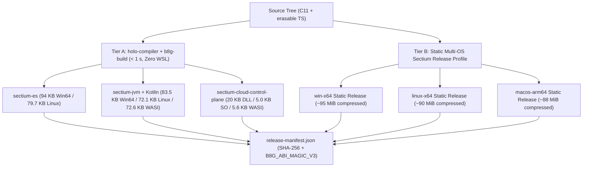

# DevOps Guide: Build, Sovereign Distribution, Installation & Code Signing

This guide explains how **Awesome-OS / Sectium / B8G** builds, distributes, installs, and signs binaries across Windows, Linux, macOS, WASI, Proxmox, and bare-metal T2 SDE UEFI — with zero gatekeeper lock-in and exact rules on when OS vendor signing is (and is not) required.

---

## 1. Two-Tier Build Architecture



### Tier A: Sub-Second `holo-compiler` Native C11 & WASI Stack (`< 1 s`)
All core systems binaries cross-compile natively on Windows 11 through **`holo-compiler`** (`intersections/holo-compiler` + `b8g-build` `.b8p` CAS, zero WSL) with `-std=c11 -O2 -Wall -s` and **0 warnings**:
- **`sectium-es`** (`sections/b8g-es/`): `94.0 KB` Win64 PE / `79.7 KB` Linux static musl ELF64 (`dup_v8=0 B`).
- **`sectium-jvm`** (`sections/b8g-jvm/`): `83.5 KB` Win64 PE / `72.1 KB` Linux ELF64 / `72.6 KB` `wasm32-wasi` (Kotlin `Intrinsics` + Tier-2 `zig cc -O3` AOT).
- **`sectium-cloud-control-plane`** (`sections/sectium-cloud-control-plane/`): `20.0 KB` Win64 `.dll` / `4.96 KB` Linux `.so` / `5.56 KB` WASI `.wasm` (`B8G_ABI_MAGIC_V3 = 0x33564742`).

### Tier B: Static Multi-OS Sectium Browser Builds
- Local dev builds use `is_component_build = true` (`~1.46 GB` across DLLs for fast incremental relinks).
- Production release builds use [`intersections/sectium-browser/installer/release-profile.mts`](../../intersections/sectium-browser/installer/release-profile.mts) (`is_component_build = false`, `use_thin_lto = true`, `symbol_level = 0`, `enable_nacl = false`, opt-in/out `proprietary_codecs`), targeting `~88–95 MiB` compressed per OS (`win-x64`, `linux-x64`, `macos-arm64`).

---

## 2. Sovereign Distribution & Installation Channels

### 2.1 Zero-Gatekeeper One-Liner Web Installers (Recommended Default)
Follows the exact distribution model proven by Rust (`rustup`), Bun, Deno, and `uv`:
- **Windows (PowerShell):**
  ```powershell
  irm https://awesome-os.com/install.ps1 | iex
  ```
- **Linux / macOS (POSIX `sh`):**
  ```sh
  curl -fsSL https://awesome-os.com/install.sh | sh
  ```
- **Why this works without OS vendor signing:**
  - Downloads directly via HTTP client (no browser **Mark-of-the-Web** `Zone.Identifier` on Windows, no `com.apple.quarantine` on macOS).
  - Strictly verifies **SHA-256** checksums against [`site/awesome-os.com/release-manifest.json`](../../site/awesome-os.com/release-manifest.json) before installing or executing.
  - Supports `-FromSource` / `--from-source` to compile locally in `< 1 s` with **`holo-compiler`** (automatically ad-hoc signed on Apple Silicon).

### 2.2 Local Windows End-User Host Installer (`D:\Sectium`)
[`intersections/sectium-browser/installer/install-sectium.mts`](../../intersections/sectium-browser/installer/install-sectium.mts) (`.\bin\sectium-install.ps1 --dir D:\Sectium`) handles every Windows shell invariant automatically:
1. Copies only runtime files (`sectium.exe`, `*.dll`, `*.pak`, `*.bin`, `*.dat`, `*.manifest`, `locales/`).
2. Stamps the multi-resolution Lumi `.ico` into **both** `sectium.exe` and `chrome.dll` (`IDR_MAINFRAME #101`).
3. Grants Windows AppContainer Sandbox `Read & Execute` ACLs (`*S-1-15-2-1` + `*S-1-5-32-545`) via `icacls` so sandboxed child processes never hit `ERROR_ACCESS_DENIED (0x5)`.
4. Enforces the `<= 250`-character Windows `.lnk` argument preflight gate.
5. Registers Desktop & Start Menu shortcuts, User `PATH`, `HKCU\...\Uninstall\Sectium`, `App Paths`, and `StartMenuInternet\Sectium`, and uses `b8g-silent-exec.exe` (`20 KB` GUI subsystem) so background daemons never pop up a terminal window on login.

### 2.3 Rolling Releases & $O(1)$ Rollback
- All nodes pull `RollingReleaseManifest` (`planeVersion`, `releaseChannel: 'rolling' | 'canary' | 'stable'`, `abiMagic: 0x33564742`, `abiVersion: 3`, `snapshotEpoch`, `bundleSha256`) via `sectium-cloud-control-plane`.
- Remote control-plane peers authenticate via **Ed25519 fingerprint-pinned handshakes** (`sections/sectium-cloud-control-plane/mtls-transport.mts`, zero external deps).
- Failed health gates roll back in $O(1)$ to the previous `.b8p` `snapshotEpoch`.

---

## 3. Code Signing Truth Table (Mandatory vs. Optional)

| Target / Channel | OS Vendor Signing Required? | Sovereign Verification Used | Notes for DevOps & OEMs |
| :--- | :--- | :--- | :--- |
| **Linux / T2 SDE / Proxmox / Bare-Metal** | **NO (0% required)** | Ed25519 + SHA-256 `.b8p` manifest | 100% sovereign; zero external CA dependency |
| **WASI (`*.wasm`)** | **NO (0% required)** | SHA-256 + WASI capability sandbox | Portable across all hosts |
| **CLI / `holo-compiler` Source Builds / `install.ps1` / `install.sh`** | **NO (0% required)** | SHA-256 manifest + Ed25519 | No browser MotW/quarantine; `holo-compiler` auto-ad-hoc-signs Apple Silicon |
| **Windows 11 User-Mode `.exe` (Direct Browser Download)** | **Optional (UX only)** | SHA-256 + optional EV Authenticode | Unsigned browser downloads trigger SmartScreen MotW prompt (bypassable via *More info -> Run anyway*); EV Authenticode removes prompt for mainstream consumers |
| **Windows Kernel Drivers (`.sys`) / MSIX Store / WDAC** | **YES (Kernel/Policy)** | WHQL / Authenticode | **Not applicable** — Sectium ships zero kernel drivers |
| **macOS Apple Silicon (Direct Browser `.dmg` Download)** | **Ad-hoc free for kernel; Notarization optional for Gatekeeper** | `codesign -s -` (free) + optional Apple Developer ID (\$99/yr) | Free ad-hoc signature satisfies kernel; Developer ID + Notarization removes Gatekeeper quarantine prompt for mainstream `.dmg` downloads |

### Enterprise & OEM Self-Signing Policy
Downstream enterprises, Linux distros, or hardware OEMs shipping Sectium or Awesome-OS appliances may sign release bundles with their **own internal PKI / Authenticode / Apple Developer ID** without modifying upstream source. Upstream Awesome-OS remains strictly sovereign and verifies all releases via **SHA-256 + Ed25519** manifests.
