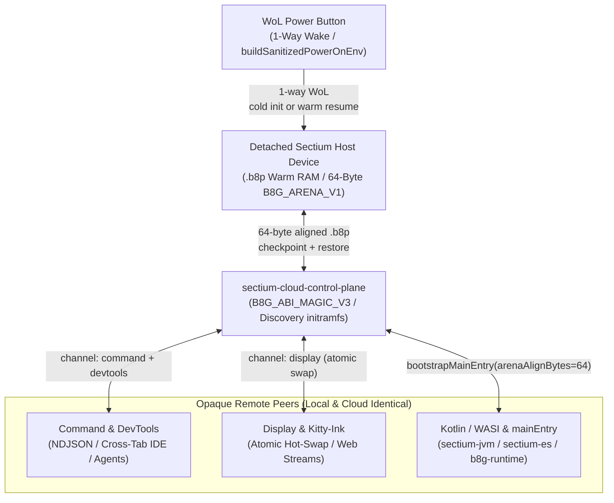

# Sectium Cloud Control Plane Architecture (`B8G_ABI_MAGIC_V3`)

> **Status:** Canonical Architecture Specification (Zero-LARP)  
> **Primary Implementation:** [`sections/sectium-cloud-control-plane/`](../../sections/sectium-cloud-control-plane/) (`b8g_sectium_cp_abi.h`, `sectium_cp.c`, `index.mts`, `sectium-cp.test.mts`)  
> **Device Boundary Prerequisite:** [`docs/architecture/SECTIUM-HOST-DEVICE-BOUNDARY.md`](./SECTIUM-HOST-DEVICE-BOUNDARY.md)

---

## 1. Flat, Collapsed Architecture

`sectium-cloud-control-plane` eliminates layered daemon hierarchies by collapsing wake-on-LAN (`WoL`) power control, `.b8p` warm-RAM checkpointing, central discovery `initramfs` bootstrapping, and opaque peer multiplexing into a single zero-dependency C11 ABI (`B8G_ABI_MAGIC_V3 = 0x33564742`) and TypeScript control plane.



---

## 2. Central Discovery `initramfs` & Merged 64-Byte RAM Alignment

`sectium-cloud-control-plane` **is** the central discovery `initramfs` across every execution substrate—bare-metal T2 SDE UEFI, Windows 11 Sectium Host, WASI, or a remote cloud node:

1. **Minimal Self-Discovery Boot:** On boot or 1-way `WoL` wake, the control plane mounts or restores the 64-byte-aligned `B8G_ARENA_V1` RAM region (`.b8p` warm checkpoint) before any user workload attaches.
2. **Merged RAM Alignment for `mainEntry` Targets:** Single-entrypoint `lo`-style systems binaries (`sectium-es`, `sectium-jvm` / Kotlin WASI, `b8g-runtime`, or Sectium Display) are registered via `bootstrapMainEntry({ id, kind, arenaAlignBytes: 64 })`, receiving deterministic 64-byte-aligned offsets inside the shared arena so zero-copy snapshots survive power-off cycles.
3. **1-Way `WoL` Warm Resume:** Calling `powerOff()` tears down live transport sockets while preserving `snapshotEpoch` and the `.b8p` RAM checkpoint. The next `wakeDetached()` detects `snapshotEpoch > 0` and performs a millisecond warm-RAM resume (`warmResumed: true`) instead of cold initialization.

---

## 3. Opaque Peer Model & Channel Isolation

Every local CLI, IDE, AI agent, display compositor, or remote cloud node connects as an **opaque peer** through `attachOpaquePeer(channel, peerId)`:

| Channel | C-ABI Enum | Semantics | Hot-Swap & Isolation Guarantee |
| :--- | :--- | :--- | :--- |
| **`command`** | `SECTIUM_CP_CHANNEL_COMMAND` (`1`) | Multi-peer serial-console (`ttyS0`) NDJSON control plane. | Multiple peers coexist; unaffected by `display` swaps. |
| **`display`** | `SECTIUM_CP_CHANNEL_DISPLAY` (`2`) | Pure visual surface sink (Sectium GPU, Kitty-Ink, `b8g-gfx-host`). | **Atomic hot-swap:** attaching a new display peer replaces the prior slot and returns `replaced_slot_id` without disrupting `command` or `devtools`. |
| **`devtools`** | `SECTIUM_CP_CHANNEL_DEVTOOLS` (`3`) | Cross-tab IDE, VS Code, Antigravity, and AI agent telemetry plane. | Bound strictly to the control plane; never injects UI chrome into `display`. |

When the control plane is offline, all channel operations fail fast with `SECTIUM_CP_ERR_DEVICE_OFFLINE` (`-2`) in C11 and `SectiumDeviceOfflineError` (`code: 'DEVICE_OFFLINE'`) in TypeScript.

---

## 4. Measured Cross-Compiled Binary Sizes (`dist/`)

All four C11 binaries are cross-compiled natively on Windows 11 via `.\bin\zig.cmd cc -std=c11 -O2 -Wall -s` with `0` warnings and zero external dependencies:

| Artifact | Target | Magic Bytes | Measured Size | Budget (`< 100 KB`) |
| :--- | :--- | :--- | :--- | :--- |
| `sections/sectium-cloud-control-plane/dist/sectium_cp.dll` | `x86_64-windows-gnu` | `4d 5a` (PE) | `20,480 B` (`20.0 KB`) | Pass |
| `sections/sectium-cloud-control-plane/dist/libsectium_cp.so` | `x86_64-linux-musl` | `7f 45 4c 46` (ELF) | `5,080 B` (`5.0 KB`) | Pass |
| `sections/sectium-cloud-control-plane/dist/sectium_cp.wasm` | `wasm32-wasi` | `00 61 73 6d` (WASM) | `5,695 B` (`5.6 KB`) | Pass |
| `sections/sectium-cloud-control-plane/dist/sectium-cp-probe.exe` | `x86_64-windows-gnu` | `4d 5a` (PE) | `24,576 B` (`24.0 KB`) | Pass |

---

## 5. Canonical C-ABI Contract (`b8g_sectium_cp_abi.h`)

### 5.1 Constants & Flat POD Status

- `B8G_ABI_MAGIC_V3 = 0x33564742u` (`"BGV3"`)
- `B8G_CP_ABI_VERSION = 3u`
- `SectiumCpStatus`: `{ uint32_t abi_magic, uint32_t abi_version, uint8_t online, uint8_t detached, uint8_t warm_resumed, uint8_t _pad, uint64_t snapshot_epoch, uint32_t command_peers, uint32_t display_peers, uint32_t devtools_peers, int32_t last_error }`

### 5.2 Exported C11 Functions

| Function | Signature | Return / Contract |
| :--- | :--- | :--- |
| `sectium_cp_abi_magic` | `uint32_t sectium_cp_abi_magic(void)` | Returns `0x33564742u`. |
| `sectium_cp_create` | `SectiumCpHandle* sectium_cp_create(const char* endpoint)` | Creates an offline control-plane instance. |
| `sectium_cp_wol_wake` | `int32_t sectium_cp_wol_wake(SectiumCpHandle* h, uint32_t power_mode, uint64_t resume_epoch)` | Transitions offline -> online (`COLD_INIT`, `WARM_RAM_RESUME`, or `DETACHED_DAEMON`). |
| `sectium_cp_checkpoint_ram` | `int32_t sectium_cp_checkpoint_ram(SectiumCpHandle* h, uint64_t* out_epoch)` | Increments `.b8p` RAM `snapshot_epoch` while online. |
| `sectium_cp_attach_channel` | `int32_t sectium_cp_attach_channel(SectiumCpHandle* h, uint32_t kind, const char* peer_id, uint32_t* out_slot_id, uint32_t* out_replaced_slot_id)` | Attaches opaque peer; atomically hot-swaps `DISPLAY`; returns `ERR_DEVICE_OFFLINE` (`-2`) when offline. |
| `sectium_cp_detach_channel` | `int32_t sectium_cp_detach_channel(SectiumCpHandle* h, uint32_t slot_id)` | Detaches a peer by slot ID. |
| `sectium_cp_power_off` | `int32_t sectium_cp_power_off(SectiumCpHandle* h)` | Powers off live transport while preserving `snapshot_epoch`. |
| `sectium_cp_status` | `int32_t sectium_cp_status(const SectiumCpHandle* h, SectiumCpStatus* out_status)` | Copies flat POD `SectiumCpStatus`. |
| `sectium_cp_destroy` | `void sectium_cp_destroy(SectiumCpHandle* h)` | Frees handle resources. |

---

## 6. Rolling-Release Plane Metadata & $O(1)$ Rollback

`SectiumCloudControlPlane` tracks an immutable `RollingReleaseManifest` tied directly to the `.b8p` `snapshotEpoch` so the control plane can roll forward continuously across `rolling`, `canary`, and `stable` channels without rebooting attached workloads:

```ts
interface RollingReleaseManifest {
  planeVersion: string;
  releaseChannel: 'rolling' | 'canary' | 'stable';
  abiMagic: number;
  abiVersion: number;
  snapshotEpoch: number;
  bundleSha256: string;
  publishedAt: string;
}
```

- **`getRollingReleaseManifest()`**: returns the active plane manifest synchronized with the current `.b8p` `snapshotEpoch`.
- **`stageRollingRelease(next)`**: enforces `next.abiMagic === B8G_ABI_MAGIC_V3` (`0x33564742`) and `next.abiVersion >= 3`, preserves the current manifest for instant recovery, and bumps `snapshotEpoch`.
- **`rollbackRollingRelease()`**: performs an $O(1)$ pointer swap back to the previous manifest and restores its `.b8p` `snapshotEpoch`.

---

## 7. Verification Checklist

1. **Native C-ABI Probe:** `.\sections\sectium-cloud-control-plane\dist\sectium-cp-probe.exe` exits `0` with `abi_magic: "0x33564742"`, `warm_resumed: 1`, and `replaced_slot_id: 3`.
2. **TypeScript Control-Plane Suite:** `.\bin\node.ps1 --test sections/sectium-cloud-control-plane/sectium-cp.test.mts` (`100% PASS`).
3. **Documentation Validation:** `.\bin\b8g-web-doc.ps1 sections/sectium-cloud-control-plane/README.md` and `.\bin\b8g-web-doc.ps1 docs/architecture/SECTIUM-CLOUD-CONTROL-PLANE.md` (`0` diagnostics).
