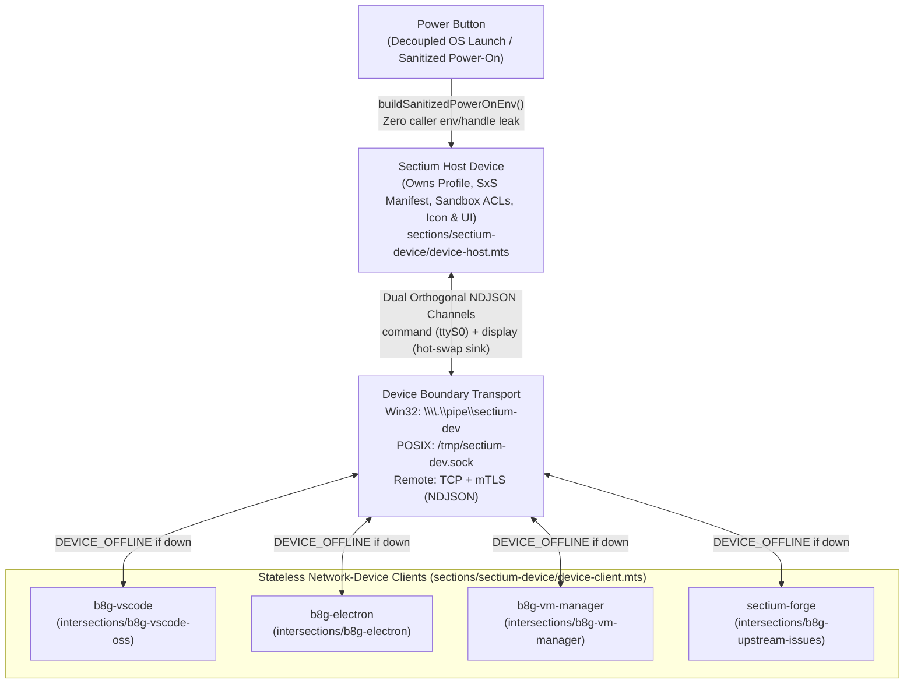

# Sectium Host Device Boundary Architecture

> **Status:** Canonical Architecture Specification (Zero-LARP)  
> **Primary Implementation:** [`sections/sectium-device/`](../../sections/sectium-device/) (`protocol.mts`, `device-host.mts`, `device-client.mts`, `devtools-plane.mts`)  
> **Workspace Enforcement Rule:** [`.agents/rules/sectium-host-device-boundary.md`](../../.agents/rules/sectium-host-device-boundary.md)  
> **Related Specifications:** [`docs/SECTIUM-VS-B8G-BOUNDARY-MANIFEST.md`](../SECTIUM-VS-B8G-BOUNDARY-MANIFEST.md) · [`.agents/rules/host-pipe-ipc-mandate.md`](../../.agents/rules/host-pipe-ipc-mandate.md)

---

## 1. Problem Statement: Why Direct `spawn(sectium.exe)` Fails

Historically, CLI tools, `.lnk` desktop shortcuts, and workspace intersections launched Sectium directly via `child_process.spawn('sectium.exe', [...])`. Treating a full browser/UI host binary as a child process of arbitrary caller tools creates two classes of systemic failure: **caller state leakage** and **silent black-hole deadspots**.

### 1.1 Caller State Leakage

1. **Ambient Environment Contamination:** Inheriting `...process.env` leaks caller-specific variables (`NODE_OPTIONS`, `ELECTRON_RUN_AS_NODE`, IDE/pnpm/agent tokens, proxy overrides, `GOOGLE_API_KEY`) into the Chromium browser process and its renderer/utility children.
2. **Console & Stdio Handle Inheritance:** Spawning a GUI subsystem binary from a terminal, PowerShell wrapper, or background daemon leaks console handles, job-object lifetimes, and `stdio` descriptors—causing orphaned console windows, broken exit codes, or premature termination when the caller exits.
3. **Profile Lock Contention (`SingletonLock`):** Concurrent callers passing overlapping `--user-data-dir` paths or writing `Default/Preferences` directly race against an already-running Sectium instance, corrupting profile state or silently delegating flags into an existing process with the wrong environment.

### 1.2 Silent Black-Hole Deadspots

Direct host spawning routinely exits with zero actionable diagnostic output when host OS invariants are violated:

| Failure Mode | Root Cause | Observed Symptom |
| :--- | :--- | :--- |
| **Missing SxS `.manifest`** | Invoking a copied or relocated `sectium.exe` outside its canonical host directory without its adjacent Side-by-Side (`sectium.exe.manifest`) assembly and versioned DLL layout. | Immediate process exit (`0xC0000135` / `0xC0150002`) with no window and no stderr output. |
| **`>260`-char `.lnk` Truncation** | Windows Shell Link (`IShellLink`) `MAX_PATH` / argument string truncation silently clips long `--user-data-dir`, `--load-extension`, or `--app=<url>` arguments. | Sectium either fails to boot or silently opens a blank default profile ignoring the requested workload. |
| **Sandbox ACL `0x5` (`ERROR_ACCESS_DENIED`)** | Chromium's Windows AppContainer / Restricted Token sandbox requires `ALL APPLICATION PACKAGES` (`S-1-15-2-1`) read/execute ACLs on the binary directory and clean handle inheritance; ad-hoc caller spawns from restricted or non-ACL'd directories fail sandbox initialization. | Renderer/GPU process crashes immediately with Win32 error `0x5`, leaving a black window or silent exit. |
| **Fire-and-Forget `detached + unref`** | Callers spawn `sectium.exe` with `stdio: 'ignore'` and immediately return `{ pid }` without verifying readiness. | Callers report success even when `sectium.exe` crashed 20 ms after launch. |

---

## 2. The Power-Button Model

Awesome-OS resolves these failure modes by **decoupling powering on Sectium from every client workload**.

Sectium is modeled as an **independent host device** (analogous to a physical display appliance or network-attached terminal), never as a library or child process owned by a CLI tool:

1. **Single Device Owner:** Sectium owns its installation directory, SxS `.manifest`, Windows Sandbox ACLs (`S-1-15-2-1`), sovereign profile (`.b8g-cas/sectium-browser-profile/`), taskbar/window icon (`sections/sectium-assets/`), and UI chrome.
2. **Explicit Power-On Only:** Pressing the "Power Button" (user-initiated OS launch, dedicated launcher, or explicit `connectOrPowerOnSectium()` fallback in `intersections/sectium-browser/cli.mts`) starts the Sectium Host Device using a **sanitized environment** (`buildSanitizedPowerOnEnv()`), stripping caller-leaking variables and pinning `GOOGLE_API_KEY=no`, `GOOGLE_DEFAULT_CLIENT_ID=no`, and `GOOGLE_DEFAULT_CLIENT_SECRET=no`.
3. **Stateless Clients:** Every intersection (`b8g-vscode`, `b8g-electron`, `b8g-vm-manager`, `sectium-forge`, `b8g-thin-client`, `sectium-explorer`) connects to the running Sectium Host Device exclusively over its IPC/network boundary. Clients **never** poke `sectium.exe`, **never** mutate its `Preferences` file, and **never** inherit or inject their own `process.env`.
4. **Clean Detach Alignment:** Because clients only speak the device protocol, Sectium remains cleanly isolated inside `sectium-bridge` (see [`SECTIUM-VS-B8G-BOUNDARY-MANIFEST.md`](../SECTIUM-VS-B8G-BOUNDARY-MANIFEST.md)) and can later be swapped for native `b8g-gfx-host` without changing client contracts.

---

## 3. Architecture Diagram

---

## 4. Dual Interchangeable Channels (Command Console + Display Sink)

The Sectium Host Device boundary cleanly splits client attachment into **two orthogonal, 100% interchangeable channels**—modeled directly after a hardware serial console (`ttyS0`) paired with a hot-swappable physical display cable:

| Channel | Analogy | Role & Capabilities | Interchangeable Clients | Lifecycle Guarantee |
| :--- | :--- | :--- | :--- | :--- |
| **Command Channel** (`channel: 'command'`) | UART / Serial Console (`ttyS0`) | Pure text/NDJSON control & diagnostics (`ping`, `status`, `open_window`, `attach_channel`, `detach_channel`, `list_channels`, structured stdout/stderr/events). | Any CLI, AI agent, automation script, or SSH/mTLS remote operator. | Works **100% headless** with zero GUI attached; attaching/detaching display sinks never interrupts command sessions. |
| **Display Channel** (`channel: 'display'`) | Hot-Swappable Display Sink | Pure visual surface / frame sink rendering host-owned state without owning process lifecycle. | Local Sectium window, native `b8g-gfx-host`, `b8g-thin-client`, or T2 SDE KMS framebuffer. | Display clients can **attach, detach, or hot-swap live** without restarting the Sectium Host Device or disrupting any active Command Channel. |

Because the two channels are decoupled by protocol, a developer or agent can boot Sectium headlessly, run diagnostics and control commands over `channel: 'command'`, hot-plug a local Sectium window or remote `b8g-thin-client` on `channel: 'display'`, unplug it, and swap to `b8g-gfx-host` or T2 SDE KMS with zero state loss.

---

## 5. DevTools Backend & Cross-Tab IDE Plane

The **Display Channel (`channel: 'display'`) stays 100% pure art**—it renders only host-owned visual surfaces with zero embedded IDE chrome, zero DevTools drawers, and zero agent sidebars. All inspection, debugging, IDE integration, and multi-tab state aggregation live exclusively on **`channel: 'command'`** via `SectiumDevToolsPlane` ([`sections/sectium-device/devtools-plane.mts`](../../sections/sectium-device/devtools-plane.mts)) and DevTools/CDP backend streams.

### 5.1 Separation of Display Art vs. DevTools Control Plane

| Plane / Surface | Bound Channel | Responsibility | Prohibited Coupling |
| :--- | :--- | :--- | :--- |
| **Display Surface** | `channel: 'display'` | Pure visual frame/canvas sink (`sectium`, `b8g-gfx-host`, `b8g-thin-client`, T2 SDE KMS). | Must never embed VS Code panels, DevTools inspector UI, or agent overlays into the display chrome. |
| **DevTools & Cross-Tab IDE Plane** | `channel: 'command'` | Aggregates cross-tab context, binds external IDEs/agents (`vscode`, `antigravity`, `agent`, `cli`), and streams CDP + structured lifecycle events. | Must never require a mounted Display Channel or mutate display-sink lifecycle. |

### 5.2 Core Capabilities (`SectiumDevToolsPlane`)

1. **Cross-Tab Context Registry:** Tracks every active tab (`registerTab({ tabId, url, title, origin })`, `unregisterTab(tabId)`, `listTabs()`, `updateTabContext(tabId, patch)`) and exposes a unified `getCrossTabContext()` snapshot aggregating all open tabs, deduplicated origins, active tab ID, selection/focus metadata, and all bound IDE/agent clients.
2. **IDE & DevTools Client Binding:** Multiple external tooling clients attach and detach interchangeably over `channel: 'command'` via `attachDevToolsClient(clientId, kind)` (`'vscode' | 'antigravity' | 'agent' | 'cli'`), `detachDevToolsClient(clientId)`, and `listDevToolsClients()`.
3. **Structured Event Stream & Standard Web Streams:** `onEvent(cb)` emits typed `channel: 'command'` events (`tab-registered`, `tab-unregistered`, `tab-context-updated`, `devtools-attached`, `devtools-detached`), and `createEventStream(): ReadableStream<SectiumDevToolsEvent>` exposes a native WHATWG `ReadableStream` supporting `.tee()`, `TransformStream`, and `WritableStream` fan-out so VS Code, Antigravity, DevTools, and AI agents maintain live cross-tab visibility while the Display UI remains untouched.

### 5.3 HTML5 `<b8g-*>` Streaming Web Component Unification

All three device-boundary surfaces unify declaratively as standard HTML5 Custom Elements whose attributes are strictly `data-*` (zero framework-specific syntax, streamable directly over Web Streams to browsers, VS Code webviews, or ANSI/Kitty TUI sinks):

| Custom Element | Canonical Markup (Strict HTML5 `data-*`) | Bound Channel & Role |
| :--- | :--- | :--- |
| **`<b8g-sectium-command>`** | `<b8g-sectium-command data-pipe="\\.\pipe\sectium-dev" data-channel="command"></b8g-sectium-command>` | Serial-console (`ttyS0`) & DevTools control stream (`channel: 'command'`). |
| **`<b8g-sectium-display>`** | `<b8g-sectium-display data-pipe="\\.\pipe\sectium-dev" data-channel="display" data-surface="canvas"></b8g-sectium-display>` | Hot-swappable visual sink (`channel: 'display'`; pure art surface). |
| **`<b8g-sectium-devtools>`** | `<b8g-sectium-devtools data-channel="command" data-cross-tab="true"></b8g-sectium-devtools>` | Cross-tab IDE, VS Code, Antigravity, and AI agent visibility plane (`channel: 'command'`). |

---

## 6. The Network-Device Contract

Clients communicate with the Sectium Host Device over an identical **NDJSON** (UTF-8, `\n`-delimited JSON object per frame) wire protocol across all three transport bindings. In accordance with [`.agents/rules/host-pipe-ipc-mandate.md`](../../.agents/rules/host-pipe-ipc-mandate.md), local control-plane traffic **never** uses loopback HTTP (`127.0.0.1:<port>`).

### 6.1 Transport Bindings

| Deployment Scope | Transport Primitive | Canonical Address | Security Boundary |
| :--- | :--- | :--- | :--- |
| **Windows Local** | Windows Named Pipe (`node:net`) | `\\.\pipe\sectium-dev` | Local user DACL; zero TCP port exposure. |
| **POSIX Local** | Unix Domain Socket (`node:net`) | `/tmp/sectium-dev.sock` | Filesystem mode (`0600`) owner-only socket. |
| **Remote / Cross-VM** | TCP + mutual TLS (`node:tls`) | `tls://<host>:<port>` | Client & server X.509 certificates; identical NDJSON frames. |

Path resolution is centralized in `getSectiumDevicePipePath(override?: string)` inside `sections/sectium-device/protocol.mts`.

### 6.2 NDJSON Wire Protocol Operations

Every request is a single-line JSON object containing an `op` field (and optional `id` correlation token). Every response is a single-line JSON object containing `ok: boolean`.

| Operation (`op`) | Request Payload | Success Response | Implementation Status |
| :--- | :--- | :--- | :--- |
| `ping` | `{"op":"ping"}` | `{"ok":true,"pong":true,"uptimeMs":1234}` | `[IMPLEMENTED]` in `device-host.mts` / `device-client.mts` |
| `status` | `{"op":"status"}` | `{"ok":true,"version":"...","pid":4242,"pipePath":"\\\\.\\pipe\\sectium-dev","windowsOpened":2}` | `[IMPLEMENTED]` in `device-host.mts` / `device-client.mts` |
| `open_window` | `{"op":"open_window","url":"https://...","appMode":true}` | `{"ok":true,"windowId":"win-1","url":"https://..."}` | `[IMPLEMENTED]` in `device-host.mts` / `device-client.mts` |
| `attach_channel` | `{"op":"attach_channel","channel":"command"\|"display","clientId":"..."}` | `{"ok":true,"channel":"display","clientId":"...","attached":true}` | `[IMPLEMENTED]` in `device-host.mts` / `device-client.mts` |
| `detach_channel` | `{"op":"detach_channel","channel":"command"\|"display","clientId":"..."}` | `{"ok":true,"channel":"display","clientId":"...","detached":true}` | `[IMPLEMENTED]` in `device-host.mts` / `device-client.mts` |
| `list_channels` | `{"op":"list_channels"}` | `{"ok":true,"channels":{"command":[...],"display":[...]}}` | `[IMPLEMENTED]` in `device-host.mts` / `device-client.mts` |
| `attach_stream` | `{"op":"attach_stream","streamId":"...","kind":"cdp"\|"arena"\|"events"}` | `{"ok":true,"streamId":"...","attached":true}` | `[SPECIFIED / PHASE-2]` (reserved for zero-copy `B8G_ARENA_V1` & CDP pipe handoff) |

### 6.3 Explicit Typed Error Contract (`DEVICE_OFFLINE`)

When the Sectium Host Device is powered off (or unreachable), `SectiumDeviceClient` **MUST NOT** silently swallow the failure, hang indefinitely, or spawn an ad-hoc `sectium.exe` child process behind the caller's back.

1. On `ENOENT` (named pipe / Unix socket absent), `ECONNREFUSED` (stale socket / closed remote port), or connect timeout, `SectiumDeviceClient` throws a typed **`SectiumDeviceOfflineError`** with `code = 'DEVICE_OFFLINE'`.
2. Callers inspecting `err.code === 'DEVICE_OFFLINE'` must either:
   - Surface a clear, actionable message to the user (`Sectium device is powered off; power on Sectium first`), or
   - Only in designated interactive launcher entrypoints (`intersections/sectium-browser/cli.mts` via `connectOrPowerOnSectium`), invoke the decoupled, sanitized Power-Button boot sequence and then reconnect over `\\.\pipe\sectium-dev`.

---

## 7. Migration & Enforcement Matrix (`intersections/*`)

| Intersection | Current Behavior | Target Device-Boundary Contract | Migration Status | Enforcement Mechanism |
| :--- | :--- | :--- | :--- | :--- |
| `intersections/sectium-browser` | Previously spawned `sectium.exe` directly via `launchSectiumBrowser()` with `...process.env`. | Uses `SectiumDeviceClient` on `\\.\pipe\sectium-dev` first; falls back to `connectOrPowerOnSectium()` with `buildSanitizedPowerOnEnv()`. | `IMPLEMENTED` | `sections/sectium-device/sectium-device.test.mts` |
| `intersections/b8g-vscode-oss` (`b8g-vscode`) | Calls `launchSectiumBrowser({ url, appMode: true })` in `b8g-vscode-shell.mts`. | Route through `SectiumDeviceClient.openWindow(url, { appMode: true })`; surface `DEVICE_OFFLINE` if host device is off. | `PENDING` | Workspace rule + `sectium-device` client import |
| `intersections/b8g-electron` | Resolves `sectium.exe` via `resolveSharedChromeBinary()` and spawns child processes in `BrowserWindow`. | Delegate window creation to `open_window` + `attach_stream` over `\\.\pipe\sectium-dev`; remove direct `sectium.exe` spawn loops. | `PENDING` | Workspace rule + `b8g-electron` adapter cutover |
| `intersections/b8g-vm-manager` | Imports `BrowserWindow` / `resolveSharedChromeBinary()` and hardcodes `sectium.exe` paths in `cli.host.mts`. | Connect to Sectium as an external device via `SectiumDeviceClient`; remove hardcoded `D:\Sectium\sectium.exe` fallbacks. | `PENDING` | Workspace rule + `cli.host.mts` cleanup |
| `intersections/b8g-upstream-issues` (`sectium-forge`) | Headless CLI/service aliased as `sectium-forge` in `sectium-cli-registry.mts`. | Request browser surfaces strictly via `SectiumDeviceClient.openWindow()`; remain 100% functional headless when `DEVICE_OFFLINE`. | `COMPLIANT_HEADLESS` | `sectium-detach-gate.test.mts` |
| `intersections/b8g-thin-client` | Calls `launchSectiumBrowser()` in `cli.mts`. | Speak NDJSON directly to `\\.\pipe\sectium-dev` (local) or TCP+mTLS (remote); zero local `sectium.exe` spawning. | `PENDING` | Workspace rule + remote TLS transport |
| `intersections/sectium-explorer` | Calls `resolveSharedChromeBinary()` in `cli.mts`. | Open explorer surface via `SectiumDeviceClient.openWindow()` over `\\.\pipe\sectium-dev`. | `PENDING` | Workspace rule |
| `intersections/b8g-agent-host` | Persistent daemon (`:7498`); never spawns `sectium.exe` directly. | Remains decoupled daemon; Sectium UI attaches as a client surface. | `COMPLIANT` | `sectium-detach-gate.test.mts` |

---

## 8. Verification Checklist

1. **Protocol & Offline-Error Unit Suite:** Run `.\bin\node.ps1 --test sections/sectium-device/sectium-device.test.mts` to verify `DEVICE_OFFLINE` before boot, live named-pipe roundtrips (`ping`, `status`, `openWindow`), `DEVICE_OFFLINE` after `stop()`, and `buildSanitizedPowerOnEnv()` isolation.
2. **DevTools & Cross-Tab IDE Plane Suite:** Run `.\bin\node.ps1 --test sections/sectium-device/devtools-plane.test.mts` to verify cross-tab context aggregation, IDE/agent client bindings (`vscode`, `antigravity`, `agent`, `cli`), typed event streaming, and live `channel: 'command'` attachment.
3. **Document Lint & Table Integrity:** Run `.\bin\b8g-web-doc.ps1 docs/architecture/SECTIUM-HOST-DEVICE-BOUNDARY.md` (`0` diagnostics).
4. **Detach Gate Compliance:** Run `.\bin\node.ps1 --test sections/b8g-host-env/sectium-detach-gate.test.mts` to verify permanent `b8g-*` subsystems retain zero Chromium coupling.
