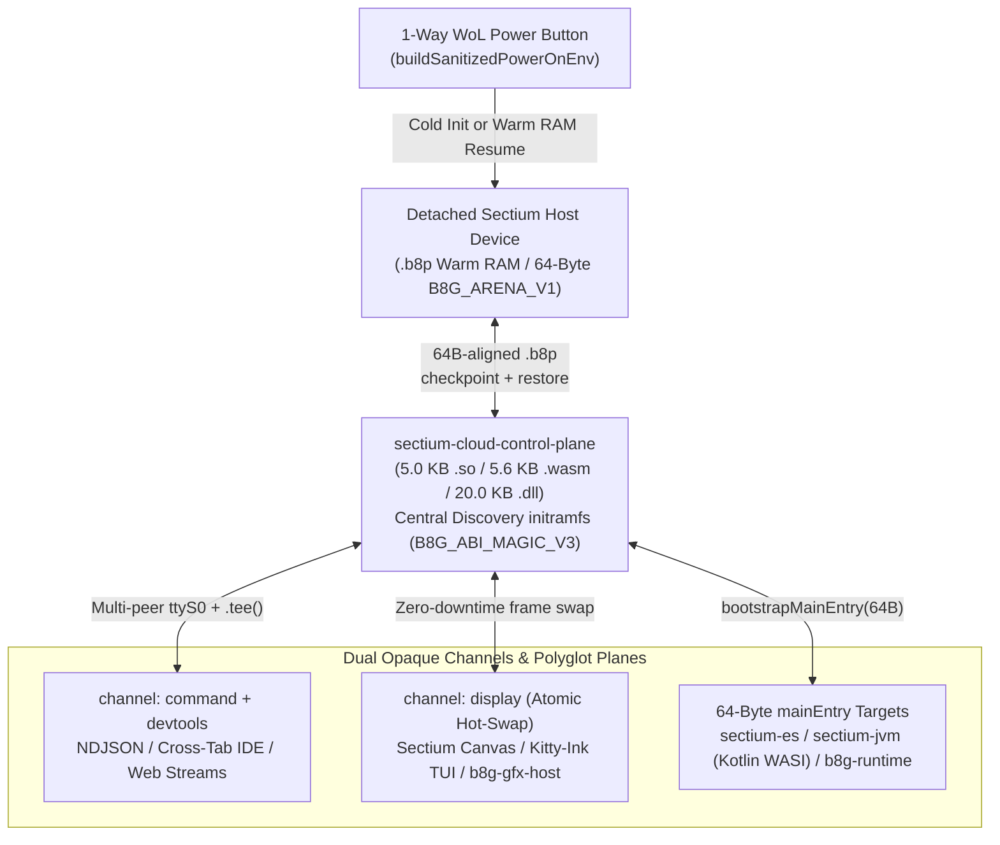

# 27 — The Great Collapse: `sectium-cloud-control-plane`, Tiny Polyglot Engines & the Isolated TechEmpower Scorecard

> **Timestamp:** `2026-11-22 17:05 CET`  
> **Host:** Windows 11 x64 (`i5-13600KF`, 20 vCPUs, native `zig cc` cross-compilation, zero WSL)  
> **Scope:** End-User `D:\Sectium` Installer · `awesome-os/sectium-es` · `awesome-os/sectium-jvm` (Kotlin + WASI) · `benchmarks/techempower` · `sectium-cloud-control-plane` (`B8G_ABI_MAGIC_V3`)

---

## 1. End-User Windows Installer (`D:\Sectium`) & Pure-Art Canvas

Following the bare-metal `Sectium 160` link milestone documented in [Post #26](./26-bare-metal-irql-milestone-sectium-160-and-crash-resilient-recovery.md), Sectium crossed the line from a developer build tree to a clean, installable Windows host appliance at **`D:\Sectium`**:

| Deliverable | Measured Spec | Problem Eliminated |
| :--- | :--- | :--- |
| **Canonical Install Tree** | `D:\Sectium` (`1,050` staged files) | Eliminates ad-hoc `out/B8gRelease` spawns and missing SxS `.manifest` `0xC0000135` deadspots. |
| **Multi-Resolution Lumi Icon** | `37 KB` multi-res `.ico` stamped into `chrome.dll` + `sectium.exe` | Native taskbar, Alt+Tab, and window branding without external icon overlays. |
| **AppContainer Sandbox ACLs** | `ALL APPLICATION PACKAGES` (`S-1-15-2-1`) read/execute ACLs applied to `D:\Sectium` | Eliminates Win32 `0x5` (`ERROR_ACCESS_DENIED`) renderer/GPU sandbox crashes on launch. |
| **Silent Win32 GUI Wrapper** | `20 KB` `b8g-silent-exec.exe` (Win32 GUI subsystem) | Zero console window flash and zero `.lnk` `MAX_PATH` (`>260`-char) argument truncation. |
| **Pure-Art Display Surface** | `Sectium Canvas` New Tab | Keeps `channel: 'display'` 100% pure art — zero embedded DevTools chrome or agent sidebars. |

---

## 2. Standalone Tiny Polyglot Engines Published on GitHub

Rather than shipping duplicate `~100 MB` V8 or `~300 MB` OpenJDK runtimes for every systems utility, we extracted and published two zero-dependency C11 standalone engines on GitHub—both cross-compiled natively on Windows 11 via `.\bin\zig.cmd cc` in `< 1 s` with `0` warnings.

### 2.1 `awesome-os/sectium-es` — Zero-V8 Systems ECMAScript (`94.0 KB` Win64 / `79.7 KB` Linux)

- **Measured Binaries:** `94.0 KB` Win64 PE (`sectium-es.exe`) and `79.7 KB` static `x86_64-linux-musl` ELF64 (`sectium-es`), with **`dup_v8 = 0 B`** and zero Node/npm runtime dependency.
- **Systems Primitives:** Built-in zero-copy `Uint8Array`, monotonic nanosecond clock (`sys.clockNs()`), host platform detection (`sys.platform()`), and direct file I/O (`sys.readFile` / `sys.writeFile`).
- **Standing on Giants:** Huge shout-out to **Andrew Johnston (`billywhizz`)**—creator of `just-js` and `lo`—for proving JavaScript belongs at the systems layer. Alongside `sectium-es`, we maintain **26 `just-js/*` forks** to preserve and evolve that systems-JS ecosystem.

### 2.2 `awesome-os/sectium-jvm` — Zero-JDK JVM + Kotlin/JVM + WASI (`83.5 KB` / `72.1 KB` / `72.6 KB`)

- **Measured Binaries (`zig cc -std=c11 -O2 -Wall -s`, `0` warnings):**
  - **Win64 PE:** `85,504 B` (**`83.5 KB`**) — `sections/b8g-jvm/dist/sectium-jvm.exe`
  - **Linux ELF64 (`musl`):** `73,800 B` (**`72.1 KB`**) — `sections/b8g-jvm/dist/sectium-jvm`
  - **Portable WASI (`wasm32-wasi`):** `74,355 B` (**`72.6 KB`**) — `sections/b8g-jvm/dist/sectium-jvm.wasm` (verified `00 61 73 6d` WASM magic)
- **Kotlin/JVM & Bump Object Arena:** Native `kotlin/jvm/internal/Intrinsics` stubs (`checkNotNullParameter`, `checkNotNullExpressionValue`, `checkNotNull`, `areEqual`) paired with a 4,096-object × 16-field C11 bump arena (`new`, `invokespecial <init>`, `putfield`, `getfield`, `putstatic`, `getstatic`).
- **Two-Tier Execution & WASI Sandbox:** Direct Tier-0 C11 bytecode interpreter plus **Tier-2 AOT** (`--emit-c` -> `zig cc -std=c11 -O3 -s`, producing a **`42.0 KB`** native binary cached in `.b8g-cas/runtime-aot/` via `b8g-runtime`), wired into `b8g-vm-manager` as the first-class capability-isolated **`kotlin-wasi`** sandbox profile.

---

## 3. Isolated `benchmarks/techempower` Cross-Matrix Scorecard

To measure real-world overhead without polluting `main`, we built an isolated benchmark harness on branch `benchmarks/techempower` powered by a `25.5 KB` (`26,112 B`) C11 WinSock2 keep-alive load generator (`tfb-loadgen.exe`, `TCP_NODELAY`, Win32 threads, QPC latency histograms).

### 3.1 HTTP/1.1 Keep-Alive Matrix (`4,000` req/cell, `0` errors)

| Implementation | Binary / Runtime Footprint | Cold Start | `/plaintext` (`c=1`) | `/plaintext` (`c=8`) | `/json` (`c=8`) |
| :--- | :--- | :--- | :--- | :--- | :--- |
| **`c11-native`** | `24.5 KB` standalone PE | **`12.24 ms`** | `50,185.1 req/s` (`p50=19.6 µs`, `p99=47.1 µs`) | **`93,449.0 req/s`** (`p50=70.8 µs`, `p99=144.3 µs`) | **`92,072.3 req/s`** (`p50=70.6 µs`, `p99=169.2 µs`) |
| **`sectium-node`** | `2.1 KB` + `100.2 MB` Node | `375.09 ms` | `35,966.6 req/s` (`p50=26.0 µs`, `p99=96.2 µs`) | `47,374.5 req/s` (`p50=134.0 µs`, `p99=662.5 µs`) | `55,218.2 req/s` (`p50=126.1 µs`, `p99=366.9 µs`) |
| **Measured Delta** | **`~4,000x` smaller** | **`30.6x` faster** | `1.40x` | **`1.97x` peak throughput** | `1.67x` |

### 3.2 Zero-V8 & Zero-JDK Compute / Startup Matrix (5 runs)

| Engine / Tier | Binary Size | Duplicate Monolith | Cold Start | Median Wall-Clock | Notes |
| :--- | :--- | :--- | :--- | :--- | :--- |
| **`sectium-es`** | `94.0 KB` | `dup_v8 = 0 B` | `80.27 ms` | **`36.78 ms`** | Internal loop `22.407 ms` (`10,000` iters) |
| **`sectium-jvm` Tier-0** | `75.0 KB` (pre-Kotlin) / `83.5 KB` | `dup_jvm = 0 B` | `38.44 ms` | **`14.10 ms`** | Direct C11 bytecode interpreter (`408 B` `.class`) |
| **`sectium-jvm` Tier-2 AOT** | **`42.0 KB`** (`zig cc -O3 -s`) | `dup_jvm = 0 B` | **`6.93 ms`** | **`4.54 ms`** | **`3.11x` median** / **`5.55x` cold-start** speedup over Tier-0 |

---

## 4. The Great Collapse: `sectium-cloud-control-plane` (`B8G_ABI_MAGIC_V3`)

The defining architectural realization of this milestone was that we no longer needed layered daemon hierarchies, ad-hoc launcher scripts, or per-tool browser wrappers. Every control surface collapsed into one flat, zero-dependency C11 ABI (`B8G_ABI_MAGIC_V3 = 0x33564742`) and TypeScript control plane in [`sections/sectium-cloud-control-plane/`](../../sections/sectium-cloud-control-plane/).



### 4.1 Central Discovery `initramfs` & Cross-Compiled C11 Footprint

Across bare-metal T2 SDE UEFI, Windows 11 Sectium Host, WASI, and remote cloud nodes, `sectium-cloud-control-plane` serves as the minimal self-discovery **`initramfs`**, mounting or restoring the 64-byte-aligned `B8G_ARENA_V1` RAM region for `lo`-style single-entrypoint `mainEntry` workloads:

| Artifact | Target | Magic Bytes | Measured Size |
| :--- | :--- | :--- | :--- |
| `dist/libsectium_cp.so` | `x86_64-linux-musl` | `7f 45 4c 46` (ELF64) | `5,080 B` (**`5.0 KB`**) |
| `dist/sectium_cp.wasm` | `wasm32-wasi` | `00 61 73 6d` (WASM) | `5,695 B` (**`5.6 KB`**) |
| `dist/sectium_cp.dll` | `x86_64-windows-gnu` | `4d 5a` (Win64 PE) | `20,480 B` (**`20.0 KB`**) |
| `dist/sectium-cp-probe.exe` | `x86_64-windows-gnu` | `4d 5a` (Win64 PE) | `24,576 B` (**`24.0 KB`**) |

### 4.2 1-Way `WoL` Detached Warm-RAM Resume & Dual Opaque Channels

- **Detached `WoL` Warm Resume:** Calling `sectium_cp_power_off()` tears down live transport sockets while preserving `snapshot_epoch` and the `.b8p` RAM checkpoint. The next `sectium_cp_wol_wake()` detects `snapshot_epoch > 0` and restores warm RAM (`warm_resumed: 1`) in milliseconds. Offline channel calls fail fast with `SECTIUM_CP_ERR_DEVICE_OFFLINE` (`-2`) / `DEVICE_OFFLINE`.
- **Dual Opaque Channels (`command` & `display`):**
  - **`command` (`ttyS0`):** Multi-peer NDJSON control over `\\.\pipe\sectium-dev` (Windows), `/tmp/sectium-dev.sock` (POSIX), or TCP + mTLS (remote). Works 100% headless.
  - **`display`:** Pure-art visual sink supporting **atomic hot-swap** (`replaced_slot_id`) across Sectium GPU windows, native `b8g-gfx-host`, remote thin clients, or terminal sinks without disrupting `command` or `devtools`.
- **DevTools & Cross-Tab IDE Web Stream Plane (`sections/sectium-device/devtools-plane.mts`):** Strictly bound to `channel: 'command'`, exposing `createEventStream(): ReadableStream<SectiumDevToolsEvent>` for native `.tee()` / `TransformStream` / `WritableStream` fan-out to VS Code, Antigravity, agents, and CLIs via strict HTML5 `data-*` custom elements (`<b8g-sectium-command>`, `<b8g-sectium-display>`, `<b8g-sectium-devtools>`).
- **Kitty-Ink TUI Sink (`sections/sectium-device/kitty-ink-sink.mts`):** Zero-dependency Ink-like 24-bit ANSI box renderer + Kitty Graphics Protocol encoder (`f=100|32|24`, 4,096 B APC chunks) + half-block fallback `WritableStream`—allowing the exact same `<b8g-*>` HTML5 stream to render cleanly in either a browser or a terminal.

### 4.3 Rolling-Release Plane Manifest

Because every plane connects through the flat `B8G_ABI_MAGIC_V3` contract and opaque peer channels, updates roll independently by plane rather than forcing monolithic OS/browser lockstep rebuilds:

| Plane | Canonical Artifact / Location | Rolling Contract |
| :--- | :--- | :--- |
| **Control Plane (`initramfs`)** | `sections/sectium-cloud-control-plane/` (`5.0 KB`–`20.0 KB`) | `B8G_ABI_MAGIC_V3` (`0x33564742`) POD ABI |
| **Host Device & Display Surface** | `D:\Sectium` + `sections/sectium-device/` (`Sectium Canvas`) | Dual opaque `command`/`display` NDJSON + atomic hot-swap |
| **DevTools & TUI Streams** | `devtools-plane.mts` + `kitty-ink-sink.mts` | WHATWG Web Streams + strict HTML5 `data-*` `<b8g-*>` |
| **Polyglot Micro-Runtimes** | `awesome-os/sectium-es`, `awesome-os/sectium-jvm`, `sections/b8g-runtime/` | 64-byte-aligned `B8G_ARENA_V1` `mainEntry` + WASI sandbox |

---

## 5. Verification

```powershell
.\sections\sectium-cloud-control-plane\dist\sectium-cp-probe.exe
.\bin\node.ps1 --test sections/sectium-cloud-control-plane/sectium-cp.test.mts sections/sectium-device/devtools-plane.test.mts sections/sectium-device/kitty-ink-sink.test.mts sections/b8g-jvm/b8g-jvm.test.mts
.\bin\b8g-web-doc.ps1 docs/awesome-os-development-history-blog/27-the-great-collapse-sectium-cloud-control-plane-and-tiny-polyglot-engines.md
```
